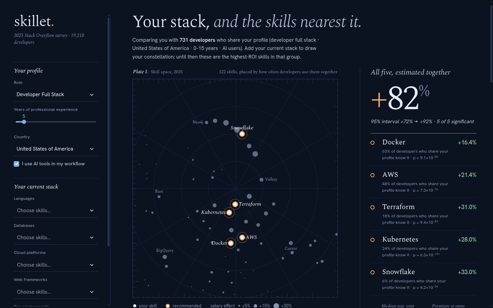
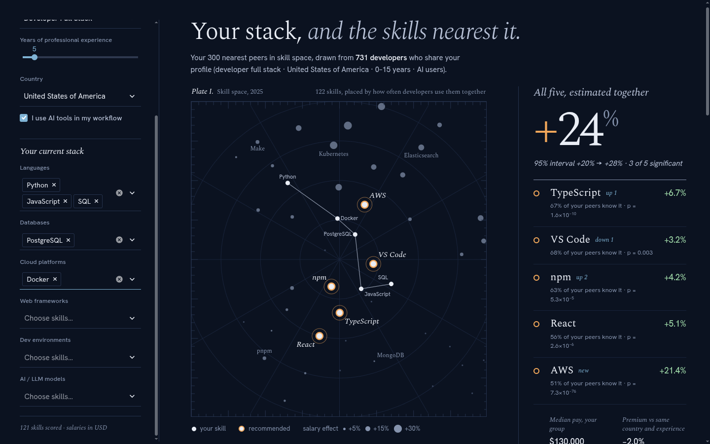
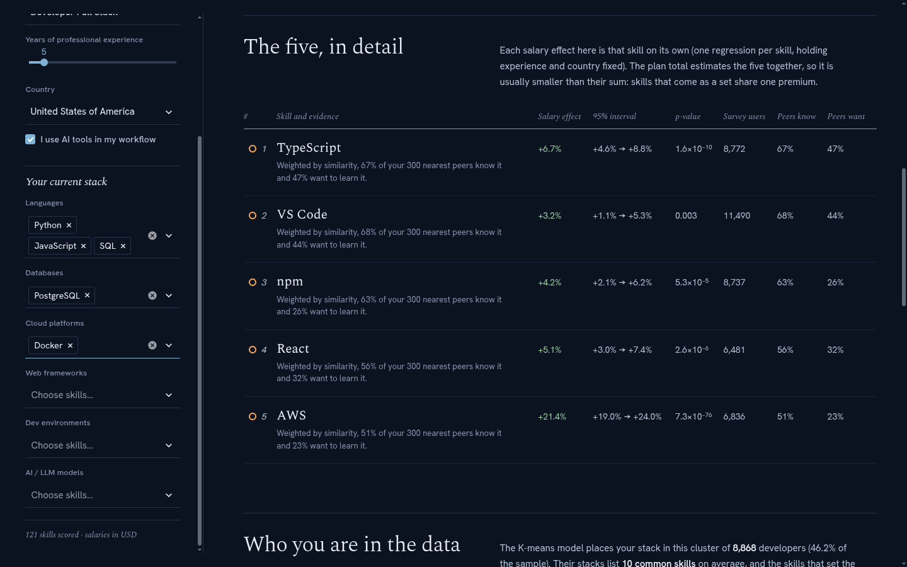
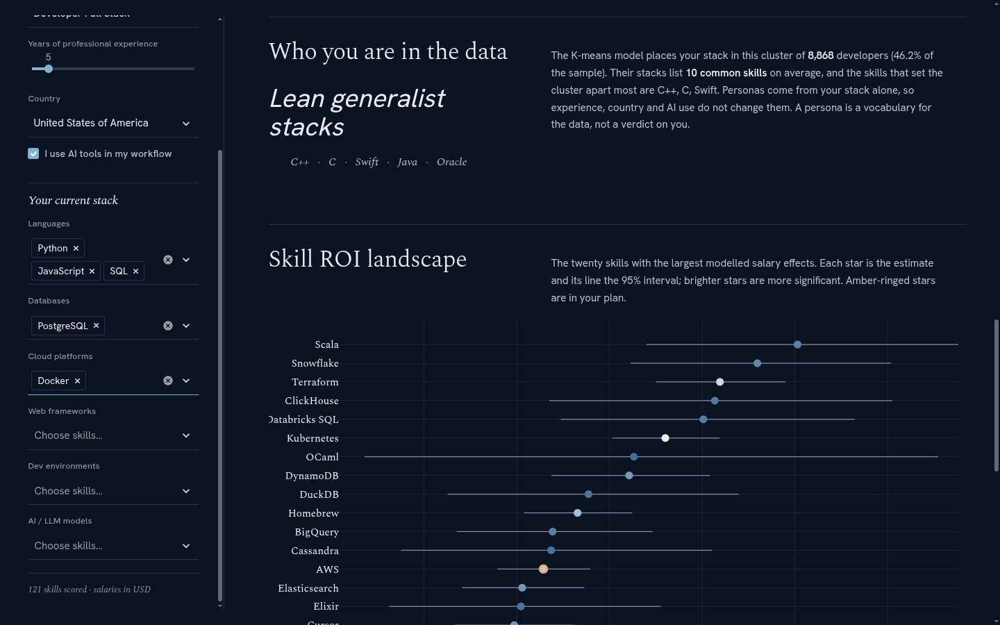
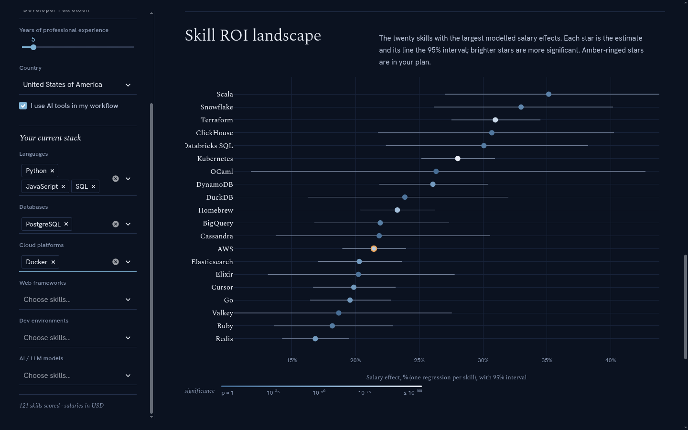
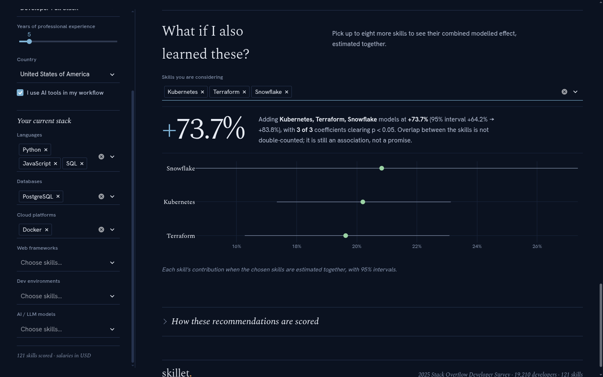
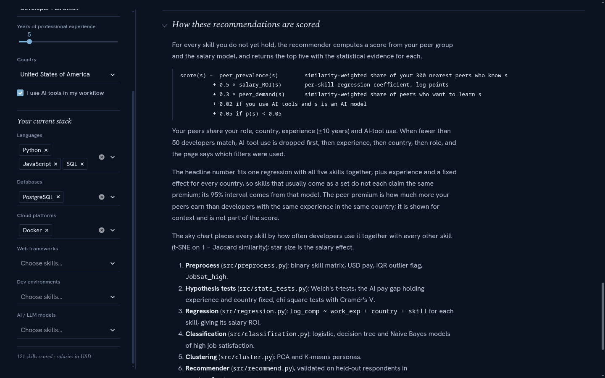
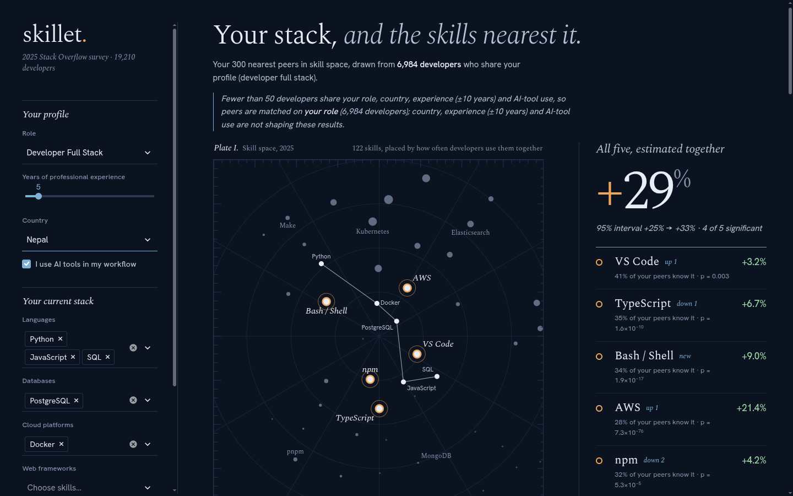

# skillet — DA 2: Software / Model Implementation

---

## DA 2: Software / Model Implementation

### 1. Brief introduction and objectives

skillet is a recommendation model that tells a software developer which five skills to learn next. It is implemented as a reproducible Python pipeline plus an interactive Streamlit web application.

- **The pipeline** cleans the 2025 Stack Overflow survey, fits every statistical model and saves the results.
- **The app** takes a developer's profile and stack and returns five recommended skills with their evidence, the combined value of the plan, and the developer's persona.

**Objectives:**

1. Rank every skill a developer does not yet have, using developers with a similar profile and stack.
2. Back each recommendation with its pay association (%), 95% confidence interval, p-value, and the shares of similar developers who know it and want to learn it.
3. Estimate the combined pay association of the five recommended skills without double-counting.
4. Identify developer personas and test common beliefs about AI-tool use, pay and satisfaction.
5. Validate the recommendations on held-out respondents.
6. Deliver the model as an interactive web application.

### 2. Dataset description and source

**Source.** Stack Overflow Developer Survey 2025, from https://survey.stackoverflow.co/. The file is downloaded by `data/download.sh`.

**Working dataset after cleaning (3):**

| Sample | Rows | Used for |
|---|---|---|
| Processed dataset | **19,210** developers × 170 columns, 156 countries | Clustering, factor analysis, network, satisfaction models, recommender peers |
| Developers with pay in USD | 18,957 | Raw t-test, ANOVA |
| Salary model sample (USD pay, not an outlier) | **18,388** developers, 151 countries | All regressions, peer pay premium |

**Variables:**

| Variable | Description | Type |
|---|---|---|
| `log_comp` | log(1 + annual pay in USD) | Continuous (response) |
| `WorkExp` | Years of professional experience, 0–50 | Continuous |
| `Country` | Country of residence | Categorical (156 levels) |
| `ai_user` | Uses AI tools in development | Binary |
| `JobSat_num`, `JobSat_high` | Job satisfaction 0–10; high = 8 or more | Numeric / binary |
| `RemoteWork`, `OrgSize` | Work arrangement, organisation size | Categorical |
| 32 `role_*` columns | Developer roles | Binary |
| **122 skill columns** | Languages (60), databases (25), platforms (20), web frameworks (15), developer environments (10), AI models (10) | Binary |
| Want sets | Skills each developer wants to work with next year | Set per developer |

### 3. Data preprocessing

Implemented in `src/preprocess.py` and `src/want.py`:

| Step | Rule | Reason |
|---|---|---|
| Population | Keep respondents who are developers by profession and employed, freelance or self-employed | The question concerns working developers |
| Experience | "Less than 1 year" → 0, "More than 50 years" → 51, then cap at 50 | A few answers of 53–100 years are implausible and would distort the slope |
| Pay | Use `ConvertedCompYearly` (USD) and model $y = \log(1 + \text{pay})$ | The local-currency field cannot be compared across countries |
| Outliers | Keep $y$ within $Q_1 - 3\,\text{IQR}$ to $Q_3 + 3\,\text{IQR}$ for salary models | Removes impossible entries (e.g. \$1 per year) while keeping genuine high earners |
| Satisfaction | `JobSat_high` = 1 if JobSat ≥ 8 | Gives a balanced binary target (50.3% positive) |
| Skills | Split each multi-select answer into one 0/1 column per skill | Gives the developer × skill matrix |
| Want sets | Parse the *WantToWorkWith* answers with the same column names | The demand signal for the recommender |
| Missing values | Drop rows missing experience, pay or satisfaction. Keep the 253 respondents whose pay could not be converted to USD for the skill-only analyses | Keeps the clustering independent of pay availability |

### 4. Model methodology and implementation

**Technology.**
- **Analysis:** Python 3, pandas, NumPy, statsmodels (regression and tests), scikit-learn (classification, PCA, K-means, nearest neighbours, t-SNE), factor_analyzer, NetworkX, SciPy.
- **App:** Streamlit and Plotly.

**Pipeline** (`make all`, or `run_all.py` followed by the analysis modules):

| Module | What it does | Output |
|---|---|---|
| `src/preprocess.py` | Cleaning and skill matrix | `data/processed.parquet` |
| `src/want.py` | Want-to-work-with sets | `data/want_sets.parquet` |
| `src/stats_tests.py` | Hypothesis tests | `data/stats_tests.json` |
| `src/regression.py` | Simple regression, multiple regression, per-skill salary ROI | `data/skill_roi.csv` |
| `src/classification.py` | Satisfaction classifiers | `data/satisfaction_*` |
| `src/cluster.py` | PCA, K-means, dendrogram | `data/cluster_model.joblib` |
| `src/fa.py`, `src/anova.py`, `src/network.py` | Factor analysis, ANOVA, skill network | JSON and figures |
| `src/skymap.py` | t-SNE skill map for the app | `data/skill_map.json` |
| `src/salary_calc.py` | Joint plan valuation | Used live by the app |
| `src/recommend.py` | The recommender (`SkillRadar`) | Used live by the app |
| `src/evaluate.py` | Held-out evaluation | `data/recommender_eval.json` |
| `app/streamlit_app.py` | Web application | — |

**The recommendation algorithm** (`src/recommend.py`), for a user with role $\rho$, experience $x^{\star}$, country $c^{\star}$, AI use $a^{\star}$ and stack $S^{\star}$:

1. **Profile filter.** Keep developers with the same role and country, experience within ±10 years, and the same AI use. If fewer than 50 remain, drop filters in the order AI → experience → country → role, and tell the user which were dropped.
2. **Nearest neighbours.** Rank the filtered developers by Jaccard distance to the user's stack and keep the closest $k = 300$.
3. **Similarity weights.** Weight each neighbour by its similarity, normalised to sum to 1.
4. **Peer signals.** For each skill the user lacks: *know* = the weighted share of neighbours who use it; *want* = the weighted share who want to learn it.
5. **Score.** Combine relevance, salary value, demand and a significance bonus (5.6). Keep only skills with a positive salary effect that more than 2% of peers know. Return the top five.
6. **Plan value.** Fit one joint regression on the five skills (5.4).
7. **Context.** Report the peers' median pay, their pay premium over developers with the same experience and country, and the user's persona.

**Empty stack (cold start).** With no stack, there are no neighbours. Skills are then ranked by salary coefficient + 0.3 × their share in the profile group, plus the same bonuses.

**Web application.** The page has:
- a left rail for the inputs;
- a "sky chart" that places all 122 skills by co-usage and draws the user's stack as a constellation, with the five picks ringed in amber;
- a plan panel with the joint uplift, its 95% interval and the five ranked skills;
- an evidence table;
- the persona;
- a chart of the top-20 skill pay effects;
- a "what if" calculator for any set of skills;
- method notes.

It runs locally with `streamlit run app/streamlit_app.py`.

### 5. Statistical techniques used

Each technique below is stated with its formula and what that formula means in plain language.

#### 5.1 Why we model log pay

Raw pay is skewed, and it differs enormously between countries (median \$130,000 in the US, \$15,000 in India). A fixed dollar effect would mean very different things in different countries. We therefore model $y = \log(1 + \text{pay})$. A coefficient $\beta$ on a yes/no skill then multiplies pay by $e^{\beta}$, so its effect is a **percentage**:

$$\%\text{ effect} = (e^{\beta} - 1) \times 100$$

For example, TypeScript's $\beta = 0.065$ means **+6.7%**. Confidence intervals are converted the same way.

#### 5.2 Simple and multiple linear regression (Module 3)

**Simple regression:**

$$\log(\text{pay}) = \beta_0 + \beta_1 \cdot \text{experience} + \varepsilon$$

OLS chooses the line that minimises the squared vertical gaps:

$$\hat\beta_1 = \frac{\sum(x_i-\bar x)(y_i-\bar y)}{\sum (x_i - \bar x)^2}$$

$R^2 = 1 - \sum(y_i-\hat y_i)^2 / \sum(y_i-\bar y)^2$ is the share of pay variation explained.

**Multiple regression with country fixed effects:**

$$\log(\text{pay}) = \beta_0 + \beta_x\,\text{experience} + \sum_j \gamma_j\,\text{skill}_j + \sum_{c} \alpha_c\,\text{country}_c + \varepsilon$$

- **Country fixed effects.** Each country has its own dummy $\alpha_c$ (the US is the reference) that absorbs its average pay level. Every other coefficient is therefore estimated by comparing developers **within the same country**. Without this, a skill used mainly in high-pay countries would look valuable only because of where its users live.
- **Estimation.** $\hat\beta = (X^\top X)^{-1}X^\top y$, with standard errors from $\hat\sigma^2 (X^\top X)^{-1}$.
- **Multicollinearity.** $\text{VIF}_j = 1/(1 - R_j^2)$.

#### 5.3 Per-skill salary ROI

For each skill $j$, one regression is fitted separately:

$$\log(\text{pay}) = \beta_0 + \beta_x\,\text{experience} + \beta_j\,\text{skill}_j + \sum_c \alpha_c\,\text{country}_c + \varepsilon$$

- **Meaning.** $\beta_j$ is the pay difference between developers with and without skill $j$, at the same experience and in the same country. This is the skill's "salary ROI".
- **Inference.** $t = \hat\beta_j / \text{SE}$, with a p-value for $H_0: \beta_j = 0$ and a 95% interval $\hat\beta_j \pm t_{0.975}\,\text{SE}$, converted to percent.
- **Why one regression per skill?** It gives one clear, comparable number per skill for *ranking*. Skills that come in bundles would split credit in a single kitchen-sink model.

#### 5.4 Joint uplift of a plan

Adding the per-skill effects double-counts: Docker's stand-alone premium already contains part of Kubernetes', because the two are usually known together. The plan's skills are therefore fitted **together**:

$$\log(\text{pay}) = \beta_0 + \beta_x\,\text{experience} + \sum_{j \in P}\beta_j\,\text{skill}_j + \sum_c \alpha_c\,\text{country}_c + \varepsilon$$

The total is $\theta = \sum_{j\in P}\beta_j$. Its variance includes the covariances between the coefficients:

$$\operatorname{Var}(\hat\theta) = \sum_{j\in P}\sum_{k\in P}\operatorname{Cov}(\hat\beta_j,\hat\beta_k)$$

So the 95% interval $(e^{\hat\theta \pm t\,\text{SE}(\hat\theta)} - 1)\times 100$ is valid for the total.

#### 5.5 Hypothesis tests (Module 2)

**Welch's t-test** compares two means without assuming equal variances:

$$t = \frac{\bar y_1 - \bar y_2}{\sqrt{s_1^2/n_1 + s_2^2/n_2}}$$

**Controlled comparison.** The same difference is estimated by regression with experience and country fixed effects.

**Chi-square test of independence.** With expected counts $E_{ab} = \text{row}_a \cdot \text{col}_b / N$:

$$\chi^2 = \sum \frac{(O_{ab}-E_{ab})^2}{E_{ab}}, \qquad V = \sqrt{\frac{\chi^2}{N(\min(r,k)-1)}}$$

Cramér's $V$ measures the strength of association, from 0 to 1.

#### 5.6 The recommender (KNN, Module 4)

**Jaccard distance** between the user's stack $S^{\star}$ and developer $i$'s stack $S_i$:

$$d_J = 1 - \frac{|S^{\star} \cap S_i|}{|S^{\star} \cup S_i|}$$

It counts only skills at least one of them has. With 122 skills, two developers who both lack 110 of them should not count as similar for that reason.

**Similarity weights:**

$$w_i = \frac{1 - d_{J,i}}{\sum_{l}(1 - d_{J,l})}$$

**Peer signals** for skill $j$:

$$\text{know}(j) = \sum_i w_i s_{ij}, \qquad \text{want}(j) = \sum_i w_i\,\mathbf{1}[j \in W_i]$$

**Score:**

$$\text{score}(j) = \text{know}(j) + 0.5\,\hat\beta_j + 0.3\,\text{want}(j) + 0.05\,\mathbf{1}[p_j<0.05] + 0.02\,\mathbf{1}[\text{AI user and } j \text{ is an AI model}]$$

In words: relevance + value + demand + reliability.

**Peer premium.** The similarity-weighted mean residual of $\log(\text{pay}) \sim \text{experience} + \text{country}$. It shows how much more the peers earn than developers with the same experience in the same country. It is not part of the score, because it is the same for every candidate skill.

#### 5.7 Classification of job satisfaction (Module 4)

**Logistic regression:**

$$P(\text{high satisfaction}) = \frac{1}{1+e^{-(w^\top z + b)}}$$

It is fitted on standardised features with class weights and an L2 penalty.

**Other classifiers:**
- **Decision tree:** splits chosen by Gini impurity $1-\sum_k p_k^2$, maximum depth 6.
- **Gaussian Naive Bayes:** assumes features are independent given the class.

**Evaluation.** A stratified 75/25 split, the ROC curve and AUC, and a threshold chosen by Youden's $J = \text{TPR} - \text{FPR}$.

#### 5.8 PCA, K-means and hierarchical clustering (Module 5)

**PCA.** On the 86 skills known by at least 5% of developers, standardised, PCA keeps the fewest components that explain at least 80% of variance:

$$\frac{\sum_{l\le q}\lambda_l}{\sum_l \lambda_l} \ge 0.80$$

**K-means** minimises the within-cluster sum of squares:

$$\sum_r \sum_{i\in C_r}\lVert t_i - \mu_r\rVert^2$$

**Choosing k.** The number of clusters is chosen by the silhouette:

$$\bar s = \frac{1}{n}\sum_i \frac{b_i-a_i}{\max(a_i,b_i)}$$

**Ward hierarchical clustering** draws the dendrogram.

**Naming clusters.** Each cluster is named by the lift of its skills: in-cluster share ÷ overall share.

#### 5.9 Factor analysis, ANOVA and network analysis

- **Factor analysis.** $z = \Lambda f + \varepsilon$. Factors are kept by the Kaiser criterion (eigenvalue > 1) and varimax-rotated so each skill loads mainly on one factor.
- **One-way ANOVA.** $F = \dfrac{SS_B/(k-1)}{SS_W/(N-k)}$, with effect size $\eta^2 = SS_B/(SS_B+SS_W)$ and Bonferroni-corrected pairwise tests.
- **Skill network.** An edge joins two skills when their Jaccard similarity exceeds 0.30. Hubs are ranked by degree centrality, and modularity $Q$ measures community structure.

#### 5.10 Skill map (t-SNE) and evaluation

- **t-SNE.** Embeds the 122 skills in two dimensions from the distances $1 - J$, so skills used together sit together.
- **Evaluation.** On held-out respondents:
  - **hit@5** = whether a hidden skill appears in the top five;
  - **want-precision@5** = the share of the top five the respondent wants to learn;
  - 95% bootstrap intervals (2,000 resamples).

### 6. Screenshots and sample outputs

All screenshots are from the running application. Scenario: a full-stack developer in the United States with 5 years of experience who uses AI tools.

**Figure 1. First view with no stack entered (cold start).** The app compares the user with the 731 developers who share the profile and shows the highest-value skills in that group: Docker, AWS, Terraform, Kubernetes and Snowflake. Together they come to +82% (95% interval +72% to +92%).

**Figure 2. After entering a stack of Python, JavaScript, SQL, PostgreSQL and Docker.**
- **Sky chart:** the stack is drawn as a constellation, and the five recommendations are ringed in amber.
- **Picks:** TypeScript, VS Code, npm, React and AWS.
- **Plan value:** estimated together, the five are associated with +24% pay (95% interval +20% to +28%).
- **Peer facts:** the 300 nearest peers have a median pay of \$130,000 and a −2.0% premium.

**Figure 3. Evidence table.** For each recommended skill: its stand-alone salary effect, 95% interval, p-value, number of survey users, and the shares of peers who know it and want it.

**Figure 4. Persona.** The K-means model places this stack in the "Lean generalist stacks" cluster (8,868 developers, 46.2% of the sample).

**Figure 5. Skill ROI landscape.** The 20 skills with the largest pay effects in the whole survey, each with its 95% interval. Brighter markers are more significant.

**Figure 6. "What if" calculator.** Kubernetes, Terraform and Snowflake estimated together come to +73.7% (95% interval +64.2% to +83.8%), even though their separate effects add up to +92%. This is the joint model avoiding double-counting.

**Figure 7. Method notes.** The scoring formula, the peer rules and the limitations, shown on the page.

**Figure 8. Filter relaxation.** With the country set to Nepal, fewer than 50 developers match the full profile. The app matches on role only and says so on the page.

**Sample output** for the Figure 2 scenario, as returned by `SkillRadar.recommend()`:

| # | Skill | Salary effect | p-value | Peers who know it | Peers who want it | Score |
|---|---|---|---|---|---|---|
| 1 | TypeScript | +6.7% | < 0.001 | 67% | 47% | 0.895 |
| 2 | VS Code | +3.2% | 0.003 | 68% | 44% | 0.883 |
| 3 | npm | +4.2% | < 0.001 | 63% | 26% | 0.781 |
| 4 | React | +5.1% | < 0.001 | 56% | 32% | 0.727 |
| 5 | AWS | +21.4% | < 0.001 | 51% | 23% | 0.724 |

**Score check for TypeScript:** $0.671 + 0.5 \times 0.065 + 0.3 \times 0.472 + 0.05 = 0.895$.

### 7. Initial results and recommendations

**Initial results:**

- **Experience:** +3.7% pay per year ($R^2$ = 0.128).
- **Full model:** experience, country and skills explain 55.9% of pay variation.
- **Highest-paying skills:** Scala (+35%), Snowflake (+33%) and Terraform (+31%).
- **Lowest-paying skills:** Microsoft Access (−27%) and PHP (−20%).
- **AI-tool users:** they appear to earn less overall, but earn **+9.9%** more at the same experience and in the same country.
- **The recommender:** recovers a hidden skill of a held-out developer 78% of the time.

**Initial recommendations:**

- **Developers:** read the combined plan value rather than adding individual effects.
- **L&D teams:** prioritise cloud and data-platform skills, whose premiums are largest and most significant.

The final report (DA 3) gives the full analysis and its interpretation.
