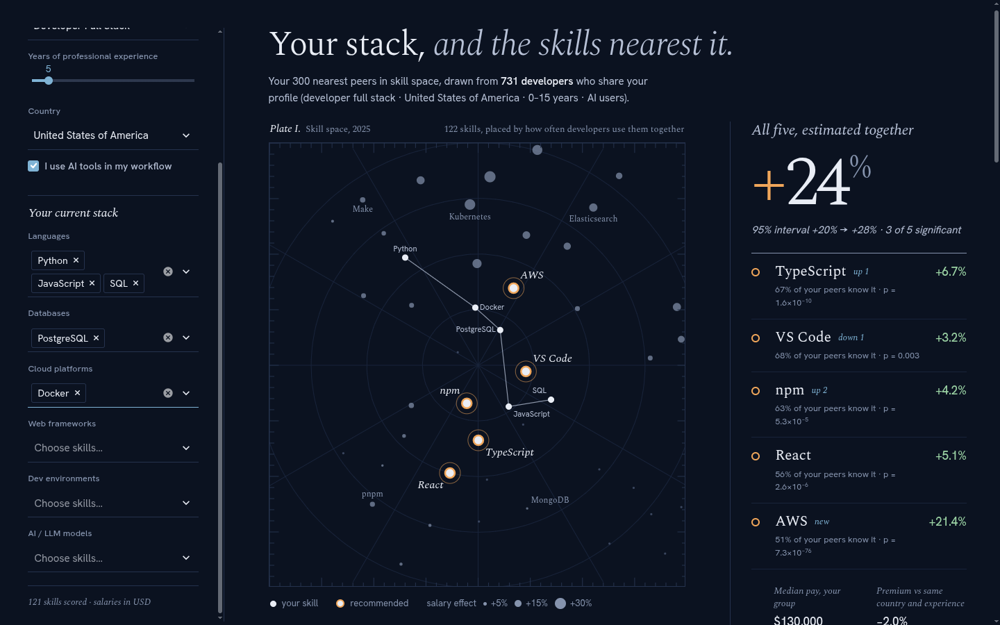
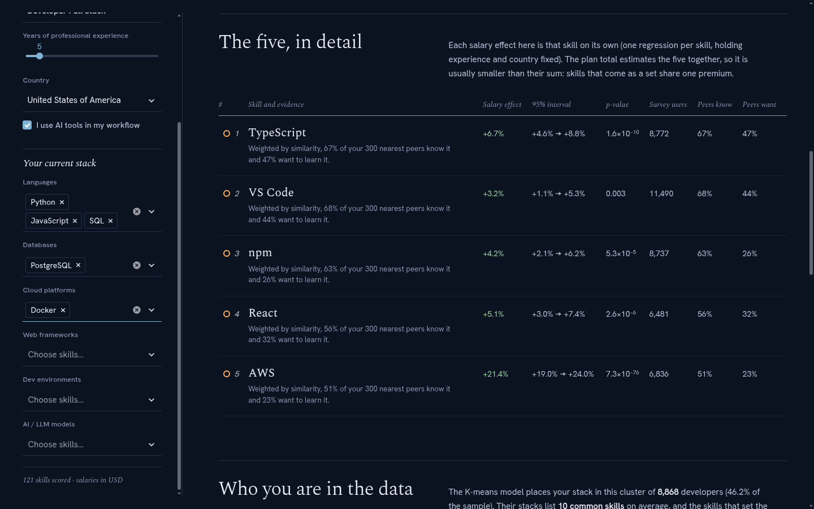
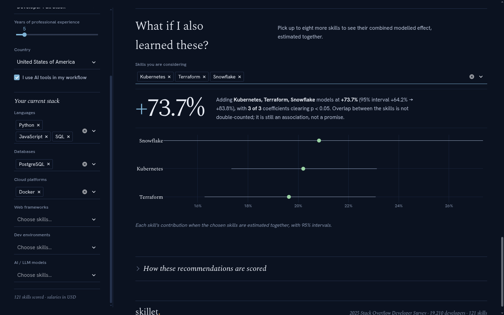
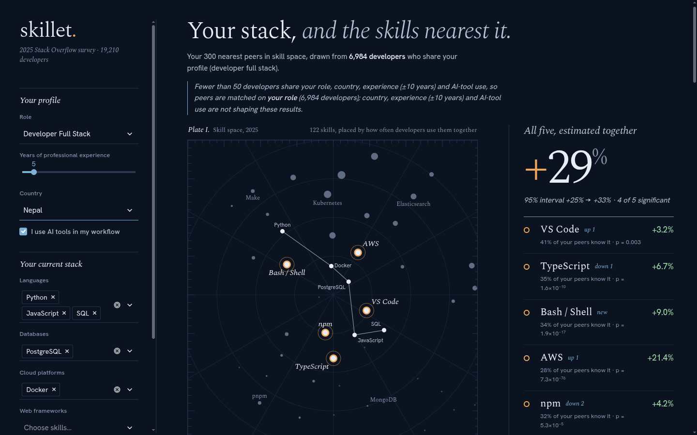

# skillet — DA 3: Final Report and Results

---

## DA 3: Final Report and Results

### 1. Introduction and problem statement

Software skills change quickly. A developer can choose from hundreds of languages, databases, cloud platforms, frameworks and AI tools, and companies spend large learning-and-development (L&D) budgets helping engineers keep up. Yet the decision of *what* to learn next is usually made on instinct, on what colleagues happen to use, or on "top skills of the year" articles.

Those sources ignore the individual (a front-end developer and a data engineer should not get the same advice), ignore evidence ("popular" is not "valuable", and "valuable" differs by country), and give no measure of certainty. Large public surveys now record what developers use, want to learn and earn, which makes an evidence-based recommendation possible.

**Problem statement.** Given a developer's role, experience, country, AI-tool use and current skills, recommend the five skills to learn next. Support each with statistical evidence of relevance, demand and pay association, holding experience and country fixed. Value the five-skill plan with a valid confidence interval.

### 2. Objectives

1. Recommend five personalised next skills from the behaviour of similar developers.
2. Attach to each skill its pay association, confidence interval, p-value, peer adoption and peer demand.
3. Estimate the combined value of the plan without double-counting.
4. Segment developers into personas and test common beliefs about AI use, pay and satisfaction.
5. Validate the recommender on held-out data against baselines.
6. Deliver a working web application.

### 3. Dataset description and methodology

#### 3.1 Dataset

| Item | Detail |
|---|---|
| Source | **Stack Overflow Developer Survey 2025**, Stack Overflow Insights, https://survey.stackoverflow.co/ (public, anonymised). The 2022–2024 surveys are used for the trend analysis. |
| Population | Respondents who are developers by profession and employed, freelance or self-employed |
| Processed dataset | **19,210** developers, 170 columns, 156 countries |
| Salary model sample | **18,388** developers (pay in USD, not an outlier), 151 countries |
| Skills | **122** binary columns: languages (60), databases (25), platforms (20), web frameworks (15), developer environments (10), AI models (10) |
| Other variables | Annual pay in USD, years of experience, country, AI-tool use, job satisfaction (0–10), remote work, organisation size, 32 role columns, and each developer's *want to work with* skills |

#### 3.2 Preprocessing

| Step | Rule | Reason |
|---|---|---|
| Pay | Use `ConvertedCompYearly` (USD); model $y = \log(1 + \text{pay})$ | Local-currency pay cannot be compared across countries |
| Outliers | Keep $y$ within $Q_1 - 3\,\text{IQR}$ to $Q_3 + 3\,\text{IQR}$ for salary models | Removes impossible entries without trimming genuine high earners |
| Experience | "Less than 1 year" → 0, capped at 50 | Implausible answers would distort the slope |
| Satisfaction | High = 8 or more out of 10 | A balanced binary target (50.3% positive) |
| Skills | One 0/1 column per answer of each multi-select question | Builds the developer × skill matrix |
| Missing values | Drop rows missing experience, pay or satisfaction | The essentials for the models |

#### 3.3 Methodology

The model has three building blocks: **value** from regression, **fit** from nearest neighbours, and **demand** from what similar developers want to learn.

**1. Value: per-skill salary regression.** For each skill $j$:

$$\log(\text{pay}) = \beta_0 + \beta_x\,\text{experience} + \beta_j\,\text{skill}_j + \sum_c \alpha_c\,\text{country}_c + \varepsilon$$

The country terms are **fixed effects**: one dummy per country absorbs its pay level, so each skill is compared only among developers in the same country. $\beta_j$ becomes a percentage pay association, $(e^{\beta_j}-1)\times 100$, with a p-value and 95% confidence interval.

**2. Fit: K-nearest neighbours with Jaccard similarity.** Keep developers with the user's role and country, experience within ±10 years and the same AI use (relaxing these filters in order if fewer than 50 match). Rank them by

$$\text{similarity} = \frac{|\text{shared skills}|}{|\text{skills either has}|}$$

keep the 300 closest, and weight each by its similarity.

**3. Demand and score.** For each skill the user lacks, $\text{know}(j)$ and $\text{want}(j)$ are the weighted shares of those peers who use it and who want to learn it. The skills are ranked by

$$\text{score}(j) = \text{know}(j) + 0.5\,\beta_j + 0.3\,\text{want}(j) + 0.05\,[p_j < 0.05] + 0.02\,[\text{AI model and AI user}]$$

Only skills with a positive pay effect are eligible. The top five are recommended.

**4. Plan value: joint regression.** The five skills are fitted together in one regression, and the plan's value is the sum of their coefficients. Its variance includes their covariances, so overlapping skills are not double-counted and the 95% interval is valid.

**Supporting analyses:**

- **Hypothesis tests:** Welch's t-test, chi-square with Cramér's V, and a controlled regression for the AI pay gap.
- **Classification of job satisfaction:** logistic regression, decision tree (Gini) and Naive Bayes, evaluated by ROC/AUC.
- **Personas:** PCA, K-means (k chosen by silhouette), hierarchical clustering (Ward dendrogram) and factor analysis.
- **Further analysis:** one-way ANOVA, a skill co-occurrence network, and t-SNE for the app's skill map.
- **Validation:** held-out respondents with hit@5, want-precision@5 and bootstrap confidence intervals.

The model is delivered as a Streamlit web application (Section 5).

### 4. Statistical analysis and interpretation of results

#### 4.1 Exploratory analysis

| Figure | Observation |
|---|---|
|  | USD pay is strongly right-skewed, which motivates modelling log pay. |
|  | Log pay rises with experience, with wide spread at every level. |
|  | 79.7% of working developers use AI tools. |

#### 4.2 Regression results

**Simple regression.** $\hat\beta_1 = 0.0362$ (p ≈ 0), $R^2 = 0.128$.

*Interpretation:* each year of experience is associated with **3.7% higher pay**, but experience alone explains only 13% of pay differences.

**Multiple regression.** With experience, 122 skills and 150 country dummies: $R^2 = 0.559$, adjusted $R^2 = 0.553$, and VIFs between 1.0 and 1.6.

*Interpretation:* skills and country together explain more than half of pay variation. Multicollinearity is not a concern.

**Per-skill salary ROI** (121 skills, 98 significant at 5%):

| Skill | Pay association | 95% CI | p-value | Users |
|---|---|---|---|---|
| Scala | +35.1% | +27.0% to +43.8% | 2.6×10⁻²¹ | 471 |
| Snowflake | +33.0% | +26.1% to +40.2% | 4.2×10⁻²⁶ | 665 |
| Terraform | +31.0% | +27.5% to +34.5% | 9.4×10⁻⁸⁷ | 2,958 |
| ClickHouse | +30.7% | +21.8% to +40.2% | 1.2×10⁻¹³ | 366 |
| Databricks SQL | +30.1% | +22.4% to +38.2% | 2.8×10⁻¹⁷ | 493 |
| Laravel | −19.1% | −22.3% to −15.8% | 5.8×10⁻²⁵ | 1,203 |
| PHP | −19.8% | −21.9% to −17.7% | 5.7×10⁻⁶¹ | 3,144 |
| VB.NET | −21.5% | −25.5% to −17.4% | 5.0×10⁻²⁰ | 694 |
| Delphi | −24.4% | −29.7% to −18.7% | 6.1×10⁻¹⁴ | 351 |
| Microsoft Access | −27.0% | −31.5% to −22.2% | 5.0×10⁻²² | 452 |


*Interpretation:* cloud infrastructure and data-platform skills carry the largest premiums over comparable developers in the same country. Legacy and some web-stack skills carry significant discounts. The negative-ROI skills are never recommended.

**Joint plan valuation.** Docker + Kubernetes + AWS + Python + Terraform: the separate effects add up to +152%, while the joint model gives **+57%** (95% CI +51% to +62%).

*Interpretation:* skills that come as a set share one premium. Valuing a plan by adding separate effects badly overstates it.

#### 4.3 Hypothesis tests

| Test | Statistic | p-value | Interpretation |
|---|---|---|---|
| Log pay, AI users vs non-users (Welch) | t = −6.15 | 8.3×10⁻¹⁰ | Raw gap favours non-users |
| Same, controlling for experience and country (OLS) | **+9.9%** [+7.3%, +12.7%], t = 7.53 | 5.2×10⁻¹⁴ | AI users earn **more** at the same experience and country |
| Job satisfaction, AI users vs non-users (Welch) | t = 3.36 (7.21 vs 7.08) | 7.8×10⁻⁴ | AI users are slightly more satisfied |
| AI use × remote work (χ², df = 5) | χ² = 10.59, V = 0.023 | 0.060 | No association |
| Primary role × JavaScript (χ², df = 13) | χ² = 2,416, V = 0.355 | < 10⁻³⁰ | Strong association |

*Interpretation (Simpson's paradox):* AI-tool use is more common in lower-paying countries, so the pooled comparison is confounded by country. Comparing within the same country and experience level reverses the sign. Pay comparisons between groups must control for country.

#### 4.4 Classification of job satisfaction

| Model | AUC | F1 | Accuracy |
|---|---|---|---|
| Logistic regression | 0.565 | 0.614 | 0.548 |
| Naive Bayes | **0.569** | 0.580 | 0.551 |
| Decision tree (depth 6) | 0.560 | 0.461 | 0.553 |


*Interpretation:* all three models are only slightly better than chance (AUC 0.5). The strongest predictors are experience (+), small organisations (+) and in-person or hybrid-in-person work (−). Satisfaction depends mainly on factors the survey does not measure, such as manager, team and autonomy. The agreement of three different methods makes this a robust finding.

#### 4.5 Personas: PCA, K-means and factor analysis

- **PCA:** 51 components explain 80.3% of variance.
- **K-means:** the silhouette is highest at **k = 3** (0.085).

| Persona | Share | Average stack size | Distinguishing skills (lift) |
|---|---|---|---|
| .NET stack | 17.9% | 21 | ASP.NET (4.8×), ASP.NET Core, NuGet, C#, Visual Studio |
| Lean generalist stacks | 46.2% | 10 | Small stacks; C++, C, Swift, Java, Oracle |
| Modern JS / web tooling | 35.9% | 27 | pnpm, Express, Yarn, Webpack, Vite |


- **Factor analysis:** 18 factors (Kaiser criterion) explain 50.1% of variance. They correspond to technology ecosystems: JavaScript front-end, .NET, Java enterprise, OpenAI tooling, Linux/DevOps, systems languages and mobile.
- **Skill network** (Jaccard > 0.30): 182 edges. The hubs are npm, Docker and SQL. Modularity is 0.21 against the personas and 0.38 for the best partition.

*Interpretation:* developers group by technology ecosystem. The low silhouette is typical of sparse binary data, but the clusters are clearly interpretable, and factor analysis independently confirms the structure.

#### 4.6 ANOVA of pay across personas

F(2, 18,954) = 16.88, p = 4.7×10⁻⁸, η² = 0.0018. Mean log pay is 11.10 (.NET), 11.00 (JS/web) and 10.94 (lean generalist). All Bonferroni-corrected pairwise tests are significant.

*Interpretation:* the differences are statistically significant but practically tiny: the persona explains 0.2% of pay. A persona describes the *kind* of stack, not its value.

#### 4.7 Recommender evaluation

Test set: 500 held-out respondents. Values in brackets are 95% bootstrap intervals.

| Method | hit@5 | want-precision@5 | Mean salary effect |
|---|---|---|---|
| Popularity (most common skills) | 0.718 [0.678, 0.756] | 0.126 | +9.5% |
| Salary only (highest ROI) | 0.054 [0.034, 0.074] | 0.052 | +31.6% |
| KNN, prevalence only | 0.786 [0.750, 0.822] | 0.137 | +10.2% |
| **skillet (KNN + ROI 0.5 + demand 0.3)** | **0.780** [0.744, 0.818] | **0.158** [0.144, 0.174] | **+12.1%** |

*Interpretation:*
- **Against the baselines:** the model recovers a hidden real skill 78% of the time, beating the popularity and salary-only baselines.
- **What the salary and demand terms add:** compared with plain prevalence, they raise the share of picks developers want (0.137 → 0.158) and the pay value of the plan (+10.2% → +12.1%) at no meaningful cost in accuracy.
- **Heavier weights:** these trade accuracy for more aspirational picks. The chosen weights sit on the balance point.

#### 4.8 Trend, 2022–2025

- **Stable leaders:** Terraform and Kubernetes have the highest premiums in all four years.
- **Falling premiums:** Docker (−10.2 points), Redis (−8.6) and Go (−6.6) lost a third of their premium as they became mainstream.


### 5. Model outputs and recommendations

**Model output.** For any profile and stack, the app returns:
- five recommended skills, each with its pay association, interval, p-value, peer adoption and demand;
- the joint value of the plan with its 95% interval;
- the peer group's median pay and premium;
- the persona;
- a calculator for any other set of skills.

Figures 5.1–5.4 show these outputs in the application for a full-stack developer in the United States with 5 years of experience who uses AI tools.

**Figure 5.1. The recommendation for a stack of Python, JavaScript, SQL, PostgreSQL and Docker.** The stack is drawn as a constellation on the skill map and the five recommendations are ringed in amber. Estimated together they are associated with +24% pay (95% interval +20% to +28%). The 300 nearest peers have a median pay of \$130,000.



**Figure 5.2. Evidence for each recommended skill:** salary effect, 95% interval, p-value, survey users, and the shares of peers who know and want it.



**Figure 5.3. The "what if" calculator.** Kubernetes, Terraform and Snowflake estimated together: +73.7% (95% interval +64.2% to +83.8%), although their separate effects add up to +92%.



**Figure 5.4. Filter relaxation.** For Nepal, fewer than 50 developers match the full profile, so the model matches on role only and says so on the page.



**Example outputs** (all from the live model):

| Profile and stack | Recommended five | Plan value (95% CI) |
|---|---|---|
| Full-stack, US, 5 yrs, no stack | Docker, AWS, Terraform, Kubernetes, Snowflake | +82% (+72% to +92%) |
| Full-stack, US, 5 yrs; Python, JavaScript, SQL, PostgreSQL, Docker | TypeScript, VS Code, npm, React, AWS | +24% (+20% to +28%) |
| Same stack, 25 yrs | VS Code, AWS, TypeScript, npm, OpenAI GPT | +28% (+24% to +32%) |
| Same stack, India | VS Code, TypeScript, React, npm, OpenAI GPT | +14% (+11% to +18%) |
| Data scientist, US; Python, SQL | VS Code, JupyterLab, PostgreSQL, Pip, Docker | +21% (+16% to +26%) |
| .NET stack (C#, SQL Server, Visual Studio, ASP.NET Core, ASP.NET, NuGet) | VS Code, TypeScript, npm, Docker, OpenAI GPT | +21% (+17% to +25%) |

**Recommendations:**

1. **Individual developers.** Use the personalised plan and read its *joint* value. Prefer skills whose interval excludes zero. Skills with high peer adoption but little pay effect (e.g. VS Code) are about fitting in with peers rather than pay.
2. **L&D managers.** Treat the three personas as training tracks. Fund cloud and data-platform skills (Terraform, AWS, Kubernetes, Snowflake, Databricks), which carry the largest and most stable premiums. Teach mainstream skills (Docker, Redis) for relevance rather than pay.
3. **HR and analytics teams.** Always control for country and experience before comparing pay between groups; the AI-tool result shows the sign can reverse otherwise. Re-run the pipeline yearly to track drift.

**Running the model.** The web application is started with:

```bash
.venv/bin/python -m streamlit run app/streamlit_app.py
```

### 6. Conclusion and future scope

**Conclusion.** skillet turns a large public survey into personalised, evidence-backed learning recommendations.

- **Regressions with country fixed effects** give each skill a pay association that is comparable across countries.
- **Profile-filtered, similarity-weighted KNN** makes the advice relevant to the individual.
- **The demand signal** adds what similar developers want to learn.
- **A joint regression** values the plan without double-counting.

The recommender beats popularity and salary-only baselines on held-out developers. The supporting analyses produced findings useful in their own right:
- a Simpson's-paradox reversal in the AI pay gap;
- the weak predictability of job satisfaction;
- three interpretable developer personas that map to technology ecosystems.

**Limitations.**
1. **Associations, not causal effects.** Only experience and country are controlled for.
2. **Survey data.** The sample is self-selected and pay is self-reported.
3. **Currency.** USD at survey exchange rates, not adjusted for purchasing power.
4. **Time.** One survey year per model.
5. **Design choices.** k = 300 peers, the 50-peer minimum and the ±10-year window are judgement calls. Only the score weights were validated.

**Future scope.**
- Purchasing-power-adjusted pay.
- Heteroskedasticity-robust standard errors.
- Country-specific skill effects (interaction terms).
- Panel or causal designs using developers' work histories.
- Learning the score weights directly (learning-to-rank).
- Recommending learning *paths* rather than single skills.
- An enterprise version that uses a company's own skills data.

### 7. References

1. Stack Overflow (2025). *Stack Overflow Developer Survey 2025*. https://survey.stackoverflow.co/
2. Stack Overflow (2022–2024). *Stack Overflow Developer Survey 2022, 2023, 2024*. https://survey.stackoverflow.co/
3. Montgomery, D. C., Peck, E. A., & Vining, G. G. (2021). *Introduction to Linear Regression Analysis* (6th ed.). Wiley.
4. Wooldridge, J. M. (2019). *Introductory Econometrics: A Modern Approach* (7th ed.). Cengage.
5. Welch, B. L. (1947). The generalization of "Student's" problem when several different population variances are involved. *Biometrika*, 34(1–2), 28–35.
6. Cramér, H. (1946). *Mathematical Methods of Statistics*. Princeton University Press.
7. Hosmer, D. W., Lemeshow, S., & Sturdivant, R. X. (2013). *Applied Logistic Regression* (3rd ed.). Wiley.
8. Youden, W. J. (1950). Index for rating diagnostic tests. *Cancer*, 3(1), 32–35.
9. Jolliffe, I. T. (2002). *Principal Component Analysis* (2nd ed.). Springer.
10. Lloyd, S. P. (1982). Least squares quantization in PCM. *IEEE Transactions on Information Theory*, 28(2), 129–137.
11. Rousseeuw, P. J. (1987). Silhouettes: a graphical aid to the interpretation and validation of cluster analysis. *Journal of Computational and Applied Mathematics*, 20, 53–65.
12. Ward, J. H. (1963). Hierarchical grouping to optimize an objective function. *Journal of the American Statistical Association*, 58(301), 236–244.
13. Kaiser, H. F. (1958). The varimax criterion for analytic rotation in factor analysis. *Psychometrika*, 23(3), 187–200.
14. Jaccard, P. (1912). The distribution of the flora in the alpine zone. *New Phytologist*, 11(2), 37–50.
15. Newman, M. E. J. (2006). Modularity and community structure in networks. *PNAS*, 103(23), 8577–8582.
16. van der Maaten, L., & Hinton, G. (2008). Visualizing data using t-SNE. *Journal of Machine Learning Research*, 9, 2579–2605.
17. Efron, B., & Tibshirani, R. J. (1993). *An Introduction to the Bootstrap*. Chapman & Hall.
18. Ricci, F., Rokach, L., & Shapira, B. (Eds.) (2022). *Recommender Systems Handbook* (3rd ed.). Springer.
19. Seabold, S., & Perktold, J. (2010). statsmodels: Econometric and statistical modeling with Python. *Proceedings of the 9th Python in Science Conference*.
20. Pedregosa, F., et al. (2011). Scikit-learn: Machine learning in Python. *Journal of Machine Learning Research*, 12, 2825–2830.
21. Streamlit Inc. (2025). *Streamlit documentation*. https://docs.streamlit.io/
