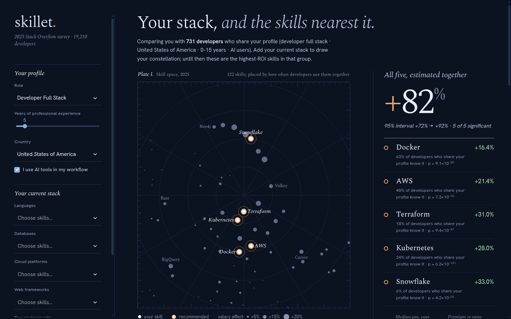
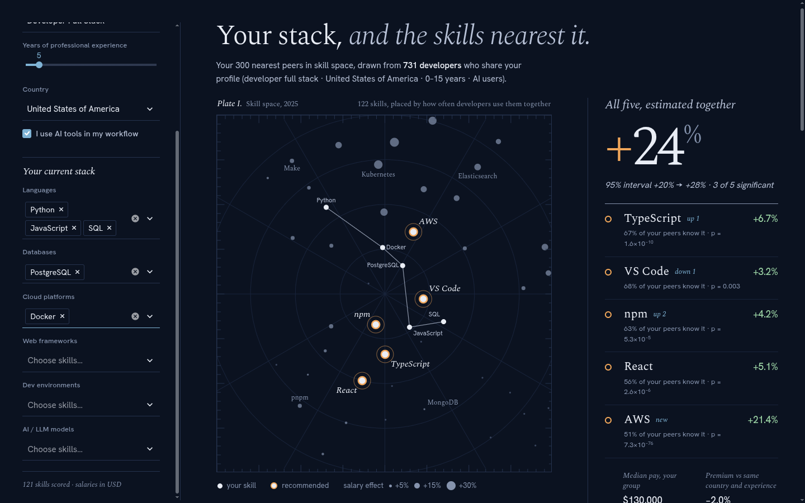
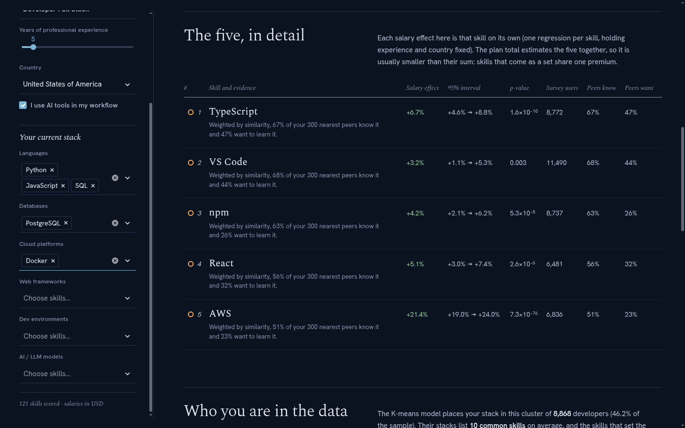
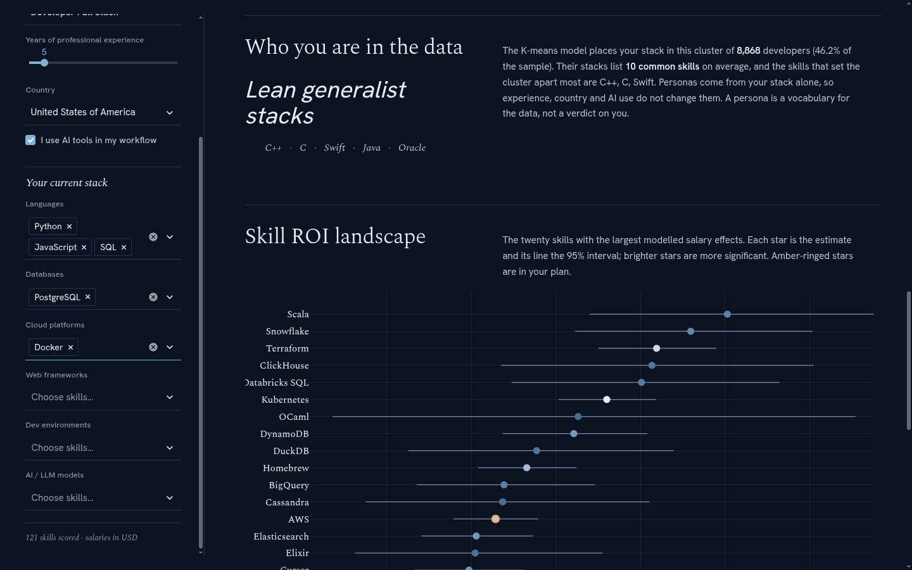
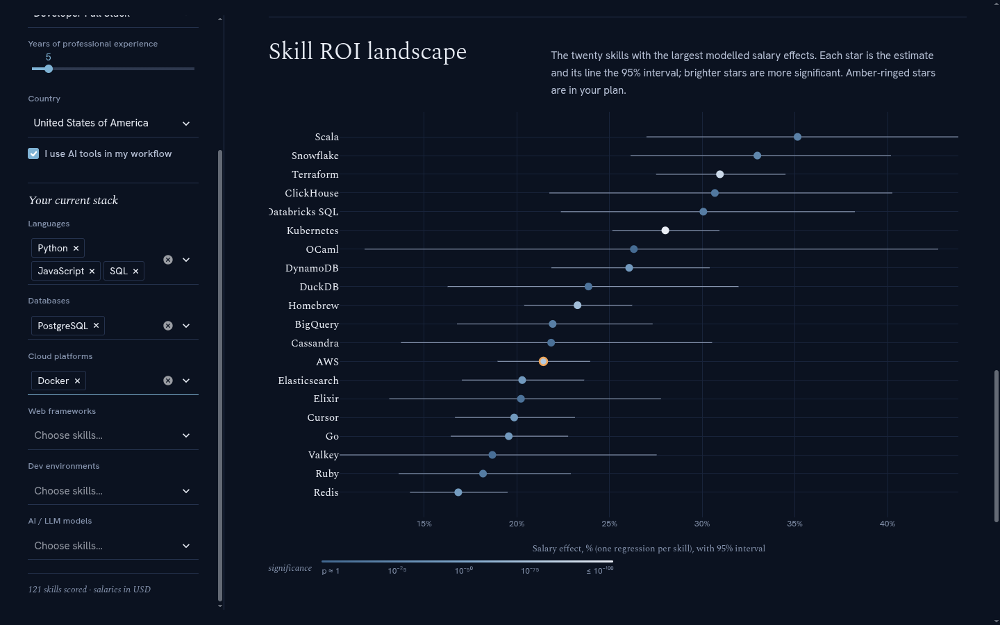
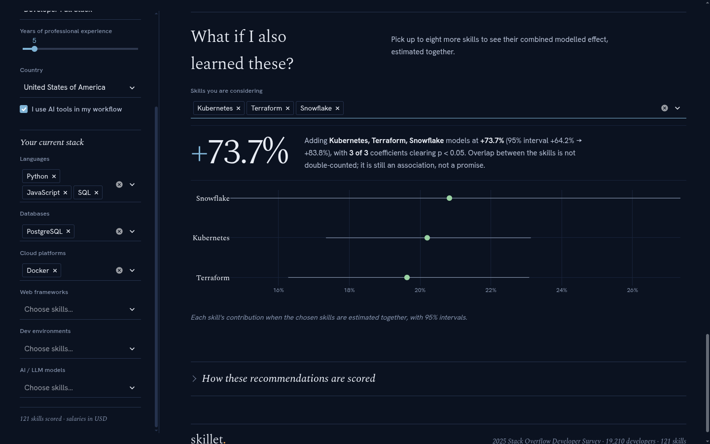
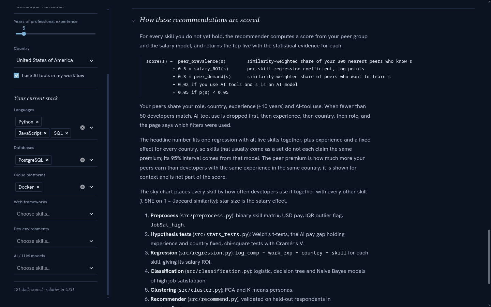
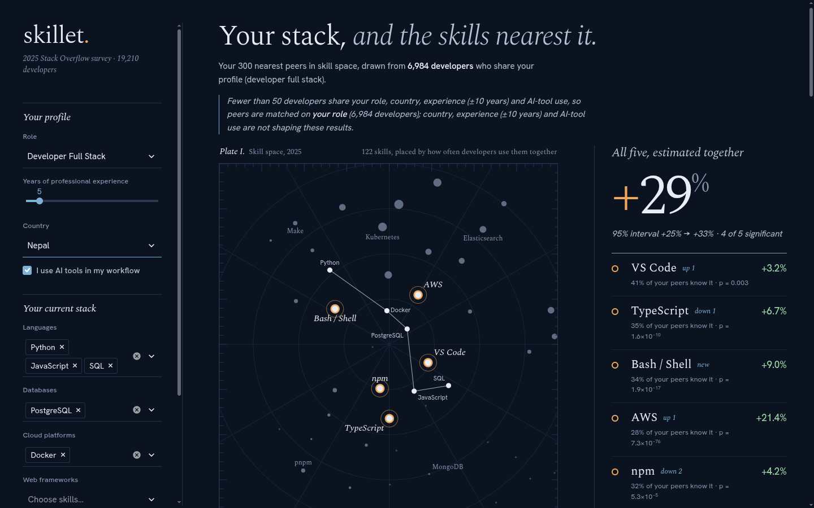

# skillet: A Recommendation Model for What Software Developers Should Learn Next

---

## Part A — DA 1: Problem / Idea of the Model

### A.1 Title of the project

**skillet: an evidence-based recommendation model that tells a software developer which five skills to learn next, using salary regressions, peer similarity and peer demand from the 2025 Stack Overflow Developer Survey.**

### A.2 Introduction and background of the problem

Software skills change quickly. A developer can choose from hundreds of languages, databases, cloud platforms, frameworks and AI tools. Companies spend large learning-and-development (L&D) budgets helping their engineers keep up. Despite that, the decision of *what* to learn next is usually made on instinct, on what colleagues happen to use, or on "top skills of the year" articles.

Those sources have three weaknesses:

1. **They ignore the individual.** A front-end developer and a data engineer should not get the same advice.
2. **They ignore evidence.** "Popular" is not the same as "valuable", and "valuable" in one country is not the same in another.
3. **They give no measure of certainty.** A claim that a skill "pays more" is rarely accompanied by a sample size, a confidence interval or a control for experience and location.

At the same time, large public datasets now record what developers use, what they want to learn, and what they earn. The Stack Overflow Developer Survey collects exactly this from tens of thousands of working developers every year. That makes a data-driven recommendation possible.

### A.3 Problem statement

> Given a developer's role, years of experience, country, use of AI tools and current skill set, recommend the **five skills they should learn next**. Back each recommendation with statistical evidence of its relevance to developers like them, the demand for it among those developers, and its association with pay, holding experience and country fixed. Estimate the combined value of the five-skill plan with a valid confidence interval.

### A.4 Objectives of the model

1. **Personalised recommendation.** Rank every skill the developer does not yet have, using the behaviour of developers with a similar profile and stack.
2. **Evidence for every recommendation.** For each skill, report the pay association (%), its 95% confidence interval and p-value, the share of similar developers who know it and the share who want to learn it.
3. **Plan valuation.** Estimate the combined pay association of the five recommended skills without double-counting skills that usually come together.
4. **Population insight.** Identify developer personas (segments) and test common beliefs, such as whether AI-tool users earn more or are more satisfied.
5. **Validation.** Show on held-out respondents that the recommendations beat simple baselines.
6. **A usable product.** Deliver the model as an interactive web application.

### A.5 Proposed dataset and its source

| Item | Detail |
|---|---|
| Dataset | **Stack Overflow Developer Survey 2025** (public, anonymised) |
| Source | Stack Overflow Insights, https://survey.stackoverflow.co/ (download of the full results file, `survey_results_public.csv`) |
| Size | About 49,000 responses and 170 questions; about 19,000 working professional developers after filtering |
| Key fields | `Employment`, `MainBranch`, `DevType` (role), `WorkExp`, `Country`, `ConvertedCompYearly` (annual pay in USD), `JobSat` (0–10), `AISelect` (AI-tool use), `RemoteWork`, `OrgSize`, and the multi-select *HaveWorkedWith* / *WantToWorkWith* questions for languages, databases, platforms, web frameworks, developer environments and AI models |
| Supporting data | The 2022, 2023 and 2024 surveys, for a multi-year trend of skill pay premiums |

### A.6 Proposed methodology and statistical techniques

The model combines three building blocks:

| Block | Technique (syllabus module) | Purpose |
|---|---|---|
| **Value** | Simple and multiple linear regression of log pay, with country fixed effects (Module 3) | Pay association of each skill, at the same experience and country |
| **Fit** | K-nearest neighbours with Jaccard similarity (Module 4) | Find developers with a similar profile and stack |
| **Demand** | Shares of similar developers who *want* each skill | Measure demand among similar developers |

Supporting analyses:

- **Data preparation and visualisation (Modules 1–2):** cleaning, outlier treatment, histograms, box plots, scatter plots, heat maps.
- **Hypothesis testing (Module 2):** Welch's t-tests and chi-square tests with Cramér's V.
- **Classification (Module 4):** logistic regression, decision tree and Naive Bayes for job satisfaction, evaluated by ROC/AUC.
- **Dimensionality reduction and clustering (Module 5):** PCA, K-means, hierarchical clustering and factor analysis to find developer personas.
- **Further analysis:** one-way ANOVA across personas, a skill co-occurrence network, and a held-out evaluation of the recommender with bootstrap confidence intervals.

**Proposed pipeline:**

1. Clean the survey and build a binary skill matrix (developer × skill).
2. Estimate each skill's salary effect with regression.
3. For a given user, filter developers with the same profile, find the most similar stacks, and score each candidate skill on relevance, value and demand.
4. Value the top five together with a joint regression.
5. Present the results in a web app.

### A.7 Expected recommendations and outcomes

- **For a developer:** a ranked list of five skills, each with its pay association and confidence interval, and with how many similar developers know it and want it. Plus the combined value of the plan.
- **For L&D managers:** developer personas that can serve as training tracks, and a ranking of skills by pay premium and reliability.
- **For HR and analytics teams:** evidence on questions such as the pay gap for AI-tool users, controlled for country and experience.
- **Expected findings, to be tested:**
  - cloud and data-platform skills carry the highest pay premiums;
  - personalised recommendations recover a developer's real next skills better than popularity or salary rankings alone;
  - job satisfaction is only weakly explained by skills.

---

## Part B — DA 2: Software / Model Implementation

### B.1 Brief introduction and objectives

skillet is implemented as a reproducible Python pipeline plus an interactive Streamlit web application.

- **The pipeline** cleans the 2025 Stack Overflow survey, fits every statistical model and saves the results.
- **The app** takes a developer's profile and stack and returns five recommended skills with their evidence, the combined value of the plan, and the developer's persona.

The objectives are those of A.4: a personalised, evidence-backed, validated recommendation delivered as a working product.

### B.2 Dataset description and source

**Source.** Stack Overflow Developer Survey 2025, from https://survey.stackoverflow.co/. The file is downloaded by `data/download.sh`.

**Working dataset after cleaning (B.3):**

| Sample | Rows | Used for |
|---|---|---|
| Processed dataset | **19,210** developers × 170 columns, 156 countries | Clustering, factor analysis, network, satisfaction models, recommender peers |
| Developers with pay in USD | 18,957 | Raw t-test, ANOVA |
| Salary model sample (USD pay, not an outlier) | **18,388** developers, 151 countries | All regressions, peer pay premium |

**Variables:**

| Variable | Description | Type |
|---|---|---|
| `log_comp` | log(1 + annual pay in USD) | Continuous (response) |
| `WorkExp` | Years of professional experience, 0–50 | Continuous |
| `Country` | Country of residence | Categorical (156 levels) |
| `ai_user` | Uses AI tools in development | Binary |
| `JobSat_num`, `JobSat_high` | Job satisfaction 0–10; high = 8 or more | Numeric / binary |
| `RemoteWork`, `OrgSize` | Work arrangement, organisation size | Categorical |
| 32 `role_*` columns | Developer roles | Binary |
| **122 skill columns** | Languages (60), databases (25), platforms (20), web frameworks (15), developer environments (10), AI models (10) | Binary |
| Want sets | Skills each developer wants to work with next year | Set per developer |

### B.3 Data preprocessing

Implemented in `src/preprocess.py` and `src/want.py`:

| Step | Rule | Reason |
|---|---|---|
| Population | Keep respondents who are developers by profession and employed, freelance or self-employed | The question concerns working developers |
| Experience | "Less than 1 year" → 0, "More than 50 years" → 51, then cap at 50 | A few answers of 53–100 years are implausible and would distort the slope |
| Pay | Use `ConvertedCompYearly` (USD) and model $y = \log(1 + \text{pay})$ | The local-currency field cannot be compared across countries |
| Outliers | Keep $y$ within $Q_1 - 3\,\text{IQR}$ to $Q_3 + 3\,\text{IQR}$ for salary models | Removes impossible entries (e.g. \$1 per year) while keeping genuine high earners |
| Satisfaction | `JobSat_high` = 1 if JobSat ≥ 8 | Gives a balanced binary target (50.3% positive) |
| Skills | Split each multi-select answer into one 0/1 column per skill | Gives the developer × skill matrix |
| Want sets | Parse the *WantToWorkWith* answers with the same column names | The demand signal for the recommender |
| Missing values | Drop rows missing experience, pay or satisfaction. Keep the 253 respondents whose pay could not be converted to USD for the skill-only analyses | Keeps the clustering independent of pay availability |

### B.4 Model methodology and implementation

**Technology.**
- **Analysis:** Python 3, pandas, NumPy, statsmodels (regression and tests), scikit-learn (classification, PCA, K-means, nearest neighbours, t-SNE), factor_analyzer, NetworkX, SciPy.
- **App:** Streamlit and Plotly.

**Pipeline** (`make all`, or `run_all.py` followed by the analysis modules):

| Module | What it does | Output |
|---|---|---|
| `src/preprocess.py` | Cleaning and skill matrix | `data/processed.parquet` |
| `src/want.py` | Want-to-work-with sets | `data/want_sets.parquet` |
| `src/stats_tests.py` | Hypothesis tests | `data/stats_tests.json` |
| `src/regression.py` | Simple regression, multiple regression, per-skill salary ROI | `data/skill_roi.csv` |
| `src/classification.py` | Satisfaction classifiers | `data/satisfaction_*` |
| `src/cluster.py` | PCA, K-means, dendrogram | `data/cluster_model.joblib` |
| `src/fa.py`, `src/anova.py`, `src/network.py` | Factor analysis, ANOVA, skill network | JSON and figures |
| `src/skymap.py` | t-SNE skill map for the app | `data/skill_map.json` |
| `src/salary_calc.py` | Joint plan valuation | Used live by the app |
| `src/recommend.py` | The recommender (`SkillRadar`) | Used live by the app |
| `src/evaluate.py` | Held-out evaluation | `data/recommender_eval.json` |
| `app/streamlit_app.py` | Web application | — |

**The recommendation algorithm** (`src/recommend.py`), for a user with role $\rho$, experience $x^{\star}$, country $c^{\star}$, AI use $a^{\star}$ and stack $S^{\star}$:

1. **Profile filter.** Keep developers with the same role and country, experience within ±10 years, and the same AI use. If fewer than 50 remain, drop filters in the order AI → experience → country → role, and tell the user which were dropped.
2. **Nearest neighbours.** Rank the filtered developers by Jaccard distance to the user's stack and keep the closest $k = 300$.
3. **Similarity weights.** Weight each neighbour by its similarity, normalised to sum to 1.
4. **Peer signals.** For each skill the user lacks: *know* = the weighted share of neighbours who use it; *want* = the weighted share who want to learn it.
5. **Score.** Combine relevance, salary value, demand and a significance bonus (B.5.6). Keep only skills with a positive salary effect that more than 2% of peers know. Return the top five.
6. **Plan value.** Fit one joint regression on the five skills (B.5.4).
7. **Context.** Report the peers' median pay, their pay premium over developers with the same experience and country, and the user's persona.

**Empty stack (cold start).** With no stack, there are no neighbours. Skills are then ranked by salary coefficient + 0.3 × their share in the profile group, plus the same bonuses.

**Web application.** The page has:
- a left rail for the inputs;
- a "sky chart" that places all 122 skills by co-usage and draws the user's stack as a constellation, with the five picks ringed in amber;
- a plan panel with the joint uplift, its 95% interval and the five ranked skills;
- an evidence table;
- the persona;
- a chart of the top-20 skill pay effects;
- a "what if" calculator for any set of skills;
- method notes.

It runs locally with `streamlit run app/streamlit_app.py`.

### B.5 Statistical techniques used

Each technique below is stated with its formula and what that formula means in plain language.

#### B.5.1 Why we model log pay

Raw pay is skewed, and it differs enormously between countries (median \$130,000 in the US, \$15,000 in India). A fixed dollar effect would mean very different things in different countries. We therefore model $y = \log(1 + \text{pay})$. A coefficient $\beta$ on a yes/no skill then multiplies pay by $e^{\beta}$, so its effect is a **percentage**:

$$\%\text{ effect} = (e^{\beta} - 1) \times 100$$

For example, TypeScript's $\beta = 0.065$ means **+6.7%**. Confidence intervals are converted the same way.

#### B.5.2 Simple and multiple linear regression (Module 3)

**Simple regression:**

$$\log(\text{pay}) = \beta_0 + \beta_1 \cdot \text{experience} + \varepsilon$$

OLS chooses the line that minimises the squared vertical gaps:

$$\hat\beta_1 = \frac{\sum(x_i-\bar x)(y_i-\bar y)}{\sum (x_i - \bar x)^2}$$

$R^2 = 1 - \sum(y_i-\hat y_i)^2 / \sum(y_i-\bar y)^2$ is the share of pay variation explained.

**Multiple regression with country fixed effects:**

$$\log(\text{pay}) = \beta_0 + \beta_x\,\text{experience} + \sum_j \gamma_j\,\text{skill}_j + \sum_{c} \alpha_c\,\text{country}_c + \varepsilon$$

- **Country fixed effects.** Each country has its own dummy $\alpha_c$ (the US is the reference) that absorbs its average pay level. Every other coefficient is therefore estimated by comparing developers **within the same country**. Without this, a skill used mainly in high-pay countries would look valuable only because of where its users live.
- **Estimation.** $\hat\beta = (X^\top X)^{-1}X^\top y$, with standard errors from $\hat\sigma^2 (X^\top X)^{-1}$.
- **Multicollinearity.** $\text{VIF}_j = 1/(1 - R_j^2)$.

#### B.5.3 Per-skill salary ROI

For each skill $j$, one regression is fitted separately:

$$\log(\text{pay}) = \beta_0 + \beta_x\,\text{experience} + \beta_j\,\text{skill}_j + \sum_c \alpha_c\,\text{country}_c + \varepsilon$$

- **Meaning.** $\beta_j$ is the pay difference between developers with and without skill $j$, at the same experience and in the same country. This is the skill's "salary ROI".
- **Inference.** $t = \hat\beta_j / \text{SE}$, with a p-value for $H_0: \beta_j = 0$ and a 95% interval $\hat\beta_j \pm t_{0.975}\,\text{SE}$, converted to percent.
- **Why one regression per skill?** It gives one clear, comparable number per skill for *ranking*. Skills that come in bundles would split credit in a single kitchen-sink model.

#### B.5.4 Joint uplift of a plan

Adding the per-skill effects double-counts: Docker's stand-alone premium already contains part of Kubernetes', because the two are usually known together. The plan's skills are therefore fitted **together**:

$$\log(\text{pay}) = \beta_0 + \beta_x\,\text{experience} + \sum_{j \in P}\beta_j\,\text{skill}_j + \sum_c \alpha_c\,\text{country}_c + \varepsilon$$

The total is $\theta = \sum_{j\in P}\beta_j$. Its variance includes the covariances between the coefficients:

$$\operatorname{Var}(\hat\theta) = \sum_{j\in P}\sum_{k\in P}\operatorname{Cov}(\hat\beta_j,\hat\beta_k)$$

So the 95% interval $(e^{\hat\theta \pm t\,\text{SE}(\hat\theta)} - 1)\times 100$ is valid for the total.

#### B.5.5 Hypothesis tests (Module 2)

**Welch's t-test** compares two means without assuming equal variances:

$$t = \frac{\bar y_1 - \bar y_2}{\sqrt{s_1^2/n_1 + s_2^2/n_2}}$$

**Controlled comparison.** The same difference is estimated by regression with experience and country fixed effects.

**Chi-square test of independence.** With expected counts $E_{ab} = \text{row}_a \cdot \text{col}_b / N$:

$$\chi^2 = \sum \frac{(O_{ab}-E_{ab})^2}{E_{ab}}, \qquad V = \sqrt{\frac{\chi^2}{N(\min(r,k)-1)}}$$

Cramér's $V$ measures the strength of association, from 0 to 1.

#### B.5.6 The recommender (KNN, Module 4)

**Jaccard distance** between the user's stack $S^{\star}$ and developer $i$'s stack $S_i$:

$$d_J = 1 - \frac{|S^{\star} \cap S_i|}{|S^{\star} \cup S_i|}$$

It counts only skills at least one of them has. With 122 skills, two developers who both lack 110 of them should not count as similar for that reason.

**Similarity weights:**

$$w_i = \frac{1 - d_{J,i}}{\sum_{l}(1 - d_{J,l})}$$

**Peer signals** for skill $j$:

$$\text{know}(j) = \sum_i w_i s_{ij}, \qquad \text{want}(j) = \sum_i w_i\,\mathbf{1}[j \in W_i]$$

**Score:**

$$\text{score}(j) = \text{know}(j) + 0.5\,\hat\beta_j + 0.3\,\text{want}(j) + 0.05\,\mathbf{1}[p_j<0.05] + 0.02\,\mathbf{1}[\text{AI user and } j \text{ is an AI model}]$$

In words: relevance + value + demand + reliability.

**Peer premium.** The similarity-weighted mean residual of $\log(\text{pay}) \sim \text{experience} + \text{country}$. It shows how much more the peers earn than developers with the same experience in the same country. It is not part of the score, because it is the same for every candidate skill.

#### B.5.7 Classification of job satisfaction (Module 4)

**Logistic regression:**

$$P(\text{high satisfaction}) = \frac{1}{1+e^{-(w^\top z + b)}}$$

It is fitted on standardised features with class weights and an L2 penalty.

**Other classifiers:**
- **Decision tree:** splits chosen by Gini impurity $1-\sum_k p_k^2$, maximum depth 6.
- **Gaussian Naive Bayes:** assumes features are independent given the class.

**Evaluation.** A stratified 75/25 split, the ROC curve and AUC, and a threshold chosen by Youden's $J = \text{TPR} - \text{FPR}$.

#### B.5.8 PCA, K-means and hierarchical clustering (Module 5)

**PCA.** On the 86 skills known by at least 5% of developers, standardised, PCA keeps the fewest components that explain at least 80% of variance:

$$\frac{\sum_{l\le q}\lambda_l}{\sum_l \lambda_l} \ge 0.80$$

**K-means** minimises the within-cluster sum of squares:

$$\sum_r \sum_{i\in C_r}\lVert t_i - \mu_r\rVert^2$$

**Choosing k.** The number of clusters is chosen by the silhouette:

$$\bar s = \frac{1}{n}\sum_i \frac{b_i-a_i}{\max(a_i,b_i)}$$

**Ward hierarchical clustering** draws the dendrogram.

**Naming clusters.** Each cluster is named by the lift of its skills: in-cluster share ÷ overall share.

#### B.5.9 Factor analysis, ANOVA and network analysis

- **Factor analysis.** $z = \Lambda f + \varepsilon$. Factors are kept by the Kaiser criterion (eigenvalue > 1) and varimax-rotated so each skill loads mainly on one factor.
- **One-way ANOVA.** $F = \dfrac{SS_B/(k-1)}{SS_W/(N-k)}$, with effect size $\eta^2 = SS_B/(SS_B+SS_W)$ and Bonferroni-corrected pairwise tests.
- **Skill network.** An edge joins two skills when their Jaccard similarity exceeds 0.30. Hubs are ranked by degree centrality, and modularity $Q$ measures community structure.

#### B.5.10 Skill map (t-SNE) and evaluation

- **t-SNE.** Embeds the 122 skills in two dimensions from the distances $1 - J$, so skills used together sit together.
- **Evaluation.** On held-out respondents:
  - **hit@5** = whether a hidden skill appears in the top five;
  - **want-precision@5** = the share of the top five the respondent wants to learn;
  - 95% bootstrap intervals (2,000 resamples).

### B.6 Screenshots and sample outputs

All screenshots are from the running application. Scenario: a full-stack developer in the United States with 5 years of experience who uses AI tools.

**Figure B.1. First view with no stack entered (cold start).** The app compares the user with the 731 developers who share the profile and shows the highest-value skills in that group: Docker, AWS, Terraform, Kubernetes and Snowflake. Together they come to +82% (95% interval +72% to +92%).



**Figure B.2. After entering a stack of Python, JavaScript, SQL, PostgreSQL and Docker.**
- **Sky chart:** the stack is drawn as a constellation, and the five recommendations are ringed in amber.
- **Picks:** TypeScript, VS Code, npm, React and AWS.
- **Plan value:** estimated together, the five are associated with +24% pay (95% interval +20% to +28%).
- **Peer facts:** the 300 nearest peers have a median pay of \$130,000 and a −2.0% premium.



**Figure B.3. Evidence table.** For each recommended skill: its stand-alone salary effect, 95% interval, p-value, number of survey users, and the shares of peers who know it and want it.



**Figure B.4. Persona.** The K-means model places this stack in the "Lean generalist stacks" cluster (8,868 developers, 46.2% of the sample).



**Figure B.5. Skill ROI landscape.** The 20 skills with the largest pay effects in the whole survey, each with its 95% interval. Brighter markers are more significant.



**Figure B.6. "What if" calculator.** Kubernetes, Terraform and Snowflake estimated together come to +73.7% (95% interval +64.2% to +83.8%), even though their separate effects add up to +92%. This is the joint model avoiding double-counting.



**Figure B.7. Method notes.** The scoring formula, the peer rules and the limitations, shown on the page.



**Figure B.8. Filter relaxation.** With the country set to Nepal, fewer than 50 developers match the full profile. The app matches on role only and says so on the page.



**Sample output** for the Figure B.2 scenario, as returned by `SkillRadar.recommend()`:

| # | Skill | Salary effect | p-value | Peers who know it | Peers who want it | Score |
|---|---|---|---|---|---|---|
| 1 | TypeScript | +6.7% | < 0.001 | 67% | 47% | 0.895 |
| 2 | VS Code | +3.2% | 0.003 | 68% | 44% | 0.883 |
| 3 | npm | +4.2% | < 0.001 | 63% | 26% | 0.781 |
| 4 | React | +5.1% | < 0.001 | 56% | 32% | 0.727 |
| 5 | AWS | +21.4% | < 0.001 | 51% | 23% | 0.724 |

**Score check for TypeScript:** $0.671 + 0.5 \times 0.065 + 0.3 \times 0.472 + 0.05 = 0.895$.

### B.7 Initial results and recommendations

**Initial results:**

- **Experience:** +3.7% pay per year ($R^2$ = 0.128).
- **Full model:** experience, country and skills explain 55.9% of pay variation.
- **Highest-paying skills:** Scala (+35%), Snowflake (+33%) and Terraform (+31%).
- **Lowest-paying skills:** Microsoft Access (−27%) and PHP (−20%).
- **AI-tool users:** they appear to earn less overall, but earn **+9.9%** more at the same experience and in the same country.
- **The recommender:** recovers a hidden skill of a held-out developer 78% of the time.

**Initial recommendations:**

- **Developers:** read the combined plan value rather than adding individual effects.
- **L&D teams:** prioritise cloud and data-platform skills, whose premiums are largest and most significant.

Part C gives the full analysis and interpretation.

---

## Part C — DA 3: Final Report and Results

### C.1 Introduction and problem statement

The choice of which skill to learn next is one of the most frequent and costly decisions in a software career. It is also one of the most important allocation decisions in corporate training budgets. Today it is mostly made without evidence (A.2).

**Problem statement.** Given a developer's role, experience, country, AI-tool use and current skills, recommend the five skills to learn next. Support each with statistical evidence of relevance, demand and pay association, holding experience and country fixed. Value the five-skill plan with a valid confidence interval.

### C.2 Objectives

1. Recommend five personalised next skills from the behaviour of similar developers.
2. Attach to each skill its pay association, confidence interval, p-value, peer adoption and peer demand.
3. Estimate the combined value of the plan without double-counting.
4. Segment developers into personas and test common beliefs about AI use, pay and satisfaction.
5. Validate the recommender on held-out data against baselines.
6. Deliver a working web application.

### C.3 Dataset description and methodology

**Dataset.** The Stack Overflow Developer Survey 2025: 19,210 working professional developers after cleaning, 122 skills and 156 countries. 18,388 developers are in the salary sample. Full description in B.2; preprocessing in B.3.

**Methodology.**

1. Clean the data and build the binary skill matrix.
2. Explore it with visualisations and hypothesis tests.
3. Estimate each skill's pay association with log-pay regressions that control for experience and country.
4. Model satisfaction with three classifiers.
5. Segment developers with PCA, K-means, factor analysis and a co-occurrence network.
6. Recommend with a profile-filtered, similarity-weighted KNN that scores relevance, value and demand.
7. Value the plan with a joint regression.
8. Validate on held-out respondents.

Formulas and their meaning are in B.5; the implementation is in B.4.

### C.4 Statistical analysis and interpretation of results

#### C.4.1 Exploratory analysis

| Figure | Observation |
|---|---|
|  | USD pay is strongly right-skewed, which motivates modelling log pay. |
|  | Log pay rises with experience, with wide spread at every level. |
|  | 79.7% of working developers use AI tools. |

#### C.4.2 Regression results

**Simple regression.** $\hat\beta_1 = 0.0362$ (p ≈ 0), $R^2 = 0.128$.

*Interpretation:* each year of experience is associated with **3.7% higher pay**, but experience alone explains only 13% of pay differences.

**Multiple regression.** With experience, 122 skills and 150 country dummies: $R^2 = 0.559$, adjusted $R^2 = 0.553$, and VIFs between 1.0 and 1.6.

*Interpretation:* skills and country together explain more than half of pay variation. Multicollinearity is not a concern.

**Per-skill salary ROI** (121 skills, 98 significant at 5%):

| Skill | Pay association | 95% CI | p-value | Users |
|---|---|---|---|---|
| Scala | +35.1% | +27.0% to +43.8% | 2.6×10⁻²¹ | 471 |
| Snowflake | +33.0% | +26.1% to +40.2% | 4.2×10⁻²⁶ | 665 |
| Terraform | +31.0% | +27.5% to +34.5% | 9.4×10⁻⁸⁷ | 2,958 |
| ClickHouse | +30.7% | +21.8% to +40.2% | 1.2×10⁻¹³ | 366 |
| Databricks SQL | +30.1% | +22.4% to +38.2% | 2.8×10⁻¹⁷ | 493 |
| Laravel | −19.1% | −22.3% to −15.8% | 5.8×10⁻²⁵ | 1,203 |
| PHP | −19.8% | −21.9% to −17.7% | 5.7×10⁻⁶¹ | 3,144 |
| VB.NET | −21.5% | −25.5% to −17.4% | 5.0×10⁻²⁰ | 694 |
| Delphi | −24.4% | −29.7% to −18.7% | 6.1×10⁻¹⁴ | 351 |
| Microsoft Access | −27.0% | −31.5% to −22.2% | 5.0×10⁻²² | 452 |


*Interpretation:* cloud infrastructure and data-platform skills carry the largest premiums over comparable developers in the same country. Legacy and some web-stack skills carry significant discounts. The negative-ROI skills are never recommended.

**Joint plan valuation.** Docker + Kubernetes + AWS + Python + Terraform: the separate effects add up to +152%, while the joint model gives **+57%** (95% CI +51% to +62%).

*Interpretation:* skills that come as a set share one premium. Valuing a plan by adding separate effects badly overstates it.

#### C.4.3 Hypothesis tests

| Test | Statistic | p-value | Interpretation |
|---|---|---|---|
| Log pay, AI users vs non-users (Welch) | t = −6.15 | 8.3×10⁻¹⁰ | Raw gap favours non-users |
| Same, controlling for experience and country (OLS) | **+9.9%** [+7.3%, +12.7%], t = 7.53 | 5.2×10⁻¹⁴ | AI users earn **more** at the same experience and country |
| Job satisfaction, AI users vs non-users (Welch) | t = 3.36 (7.21 vs 7.08) | 7.8×10⁻⁴ | AI users are slightly more satisfied |
| AI use × remote work (χ², df = 5) | χ² = 10.59, V = 0.023 | 0.060 | No association |
| Primary role × JavaScript (χ², df = 13) | χ² = 2,416, V = 0.355 | < 10⁻³⁰ | Strong association |

*Interpretation (Simpson's paradox):* AI-tool use is more common in lower-paying countries, so the pooled comparison is confounded by country. Comparing within the same country and experience level reverses the sign. Pay comparisons between groups must control for country.

#### C.4.4 Classification of job satisfaction

| Model | AUC | F1 | Accuracy |
|---|---|---|---|
| Logistic regression | 0.565 | 0.614 | 0.548 |
| Naive Bayes | **0.569** | 0.580 | 0.551 |
| Decision tree (depth 6) | 0.560 | 0.461 | 0.553 |


*Interpretation:* all three models are only slightly better than chance (AUC 0.5). The strongest predictors are experience (+), small organisations (+) and in-person or hybrid-in-person work (−). Satisfaction depends mainly on factors the survey does not measure, such as manager, team and autonomy. The agreement of three different methods makes this a robust finding.

#### C.4.5 Personas: PCA, K-means and factor analysis

- **PCA:** 51 components explain 80.3% of variance.
- **K-means:** the silhouette is highest at **k = 3** (0.085).

| Persona | Share | Average stack size | Distinguishing skills (lift) |
|---|---|---|---|
| .NET stack | 17.9% | 21 | ASP.NET (4.8×), ASP.NET Core, NuGet, C#, Visual Studio |
| Lean generalist stacks | 46.2% | 10 | Small stacks; C++, C, Swift, Java, Oracle |
| Modern JS / web tooling | 35.9% | 27 | pnpm, Express, Yarn, Webpack, Vite |


- **Factor analysis:** 18 factors (Kaiser criterion) explain 50.1% of variance. They correspond to technology ecosystems: JavaScript front-end, .NET, Java enterprise, OpenAI tooling, Linux/DevOps, systems languages and mobile.
- **Skill network** (Jaccard > 0.30): 182 edges. The hubs are npm, Docker and SQL. Modularity is 0.21 against the personas and 0.38 for the best partition.

*Interpretation:* developers group by technology ecosystem. The low silhouette is typical of sparse binary data, but the clusters are clearly interpretable, and factor analysis independently confirms the structure.

#### C.4.6 ANOVA of pay across personas

F(2, 18,954) = 16.88, p = 4.7×10⁻⁸, η² = 0.0018. Mean log pay is 11.10 (.NET), 11.00 (JS/web) and 10.94 (lean generalist). All Bonferroni-corrected pairwise tests are significant.

*Interpretation:* the differences are statistically significant but practically tiny: the persona explains 0.2% of pay. A persona describes the *kind* of stack, not its value.

#### C.4.7 Recommender evaluation

Test set: 500 held-out respondents. Values in brackets are 95% bootstrap intervals.

| Method | hit@5 | want-precision@5 | Mean salary effect |
|---|---|---|---|
| Popularity (most common skills) | 0.718 [0.678, 0.756] | 0.126 | +9.5% |
| Salary only (highest ROI) | 0.054 [0.034, 0.074] | 0.052 | +31.6% |
| KNN, prevalence only | 0.786 [0.750, 0.822] | 0.137 | +10.2% |
| **skillet (KNN + ROI 0.5 + demand 0.3)** | **0.780** [0.744, 0.818] | **0.158** [0.144, 0.174] | **+12.1%** |

*Interpretation:*
- **Against the baselines:** the model recovers a hidden real skill 78% of the time, beating the popularity and salary-only baselines.
- **What the salary and demand terms add:** compared with plain prevalence, they raise the share of picks developers want (0.137 → 0.158) and the pay value of the plan (+10.2% → +12.1%) at no meaningful cost in accuracy.
- **Heavier weights:** these trade accuracy for more aspirational picks. The chosen weights sit on the balance point.

#### C.4.8 Trend, 2022–2025

- **Stable leaders:** Terraform and Kubernetes have the highest premiums in all four years.
- **Falling premiums:** Docker (−10.2 points), Redis (−8.6) and Go (−6.6) lost a third of their premium as they became mainstream.


### C.5 Model outputs and recommendations

**Model output.** For any profile and stack, the app returns:
- five recommended skills, each with its pay association, interval, p-value, peer adoption and demand;
- the joint value of the plan with its 95% interval;
- the peer group's median pay and premium;
- the persona;
- a calculator for any other set of skills.

Figures B.1–B.8 show the outputs.

**Example outputs** (all from the live model):

| Profile and stack | Recommended five | Plan value (95% CI) |
|---|---|---|
| Full-stack, US, 5 yrs, no stack | Docker, AWS, Terraform, Kubernetes, Snowflake | +82% (+72% to +92%) |
| Full-stack, US, 5 yrs; Python, JavaScript, SQL, PostgreSQL, Docker | TypeScript, VS Code, npm, React, AWS | +24% (+20% to +28%) |
| Same stack, 25 yrs | VS Code, AWS, TypeScript, npm, OpenAI GPT | +28% (+24% to +32%) |
| Same stack, India | VS Code, TypeScript, React, npm, OpenAI GPT | +14% (+11% to +18%) |
| Data scientist, US; Python, SQL | VS Code, JupyterLab, PostgreSQL, Pip, Docker | +21% (+16% to +26%) |
| .NET stack (C#, SQL Server, Visual Studio, ASP.NET Core, ASP.NET, NuGet) | VS Code, TypeScript, npm, Docker, OpenAI GPT | +21% (+17% to +25%) |

**Recommendations:**

1. **Individual developers.** Use the personalised plan and read its *joint* value. Prefer skills whose interval excludes zero. Skills with high peer adoption but little pay effect (e.g. VS Code) are about fitting in with peers rather than pay.
2. **L&D managers.** Treat the three personas as training tracks. Fund cloud and data-platform skills (Terraform, AWS, Kubernetes, Snowflake, Databricks), which carry the largest and most stable premiums. Teach mainstream skills (Docker, Redis) for relevance rather than pay.
3. **HR and analytics teams.** Always control for country and experience before comparing pay between groups; the AI-tool result shows the sign can reverse otherwise. Re-run the pipeline yearly to track drift.

**Running the model.** The web application is started with:

```bash
.venv/bin/python -m streamlit run app/streamlit_app.py
```

### C.6 Conclusion and future scope

**Conclusion.** skillet turns a large public survey into personalised, evidence-backed learning recommendations.

- **Regressions with country fixed effects** give each skill a pay association that is comparable across countries.
- **Profile-filtered, similarity-weighted KNN** makes the advice relevant to the individual.
- **The demand signal** adds what similar developers want to learn.
- **A joint regression** values the plan without double-counting.

The recommender beats popularity and salary-only baselines on held-out developers. The supporting analyses produced findings useful in their own right:
- a Simpson's-paradox reversal in the AI pay gap;
- the weak predictability of job satisfaction;
- three interpretable developer personas that map to technology ecosystems.

**Limitations.**
1. **Associations, not causal effects.** Only experience and country are controlled for.
2. **Survey data.** The sample is self-selected and pay is self-reported.
3. **Currency.** USD at survey exchange rates, not adjusted for purchasing power.
4. **Time.** One survey year per model.
5. **Design choices.** k = 300 peers, the 50-peer minimum and the ±10-year window are judgement calls. Only the score weights were validated.

**Future scope.**
- Purchasing-power-adjusted pay.
- Heteroskedasticity-robust standard errors.
- Country-specific skill effects (interaction terms).
- Panel or causal designs using developers' work histories.
- Learning the score weights directly (learning-to-rank).
- Recommending learning *paths* rather than single skills.
- An enterprise version that uses a company's own skills data.

### C.7 References

1. Stack Overflow (2025). *Stack Overflow Developer Survey 2025*. https://survey.stackoverflow.co/
2. Stack Overflow (2022–2024). *Stack Overflow Developer Survey 2022, 2023, 2024*. https://survey.stackoverflow.co/
3. Montgomery, D. C., Peck, E. A., & Vining, G. G. (2021). *Introduction to Linear Regression Analysis* (6th ed.). Wiley.
4. Wooldridge, J. M. (2019). *Introductory Econometrics: A Modern Approach* (7th ed.). Cengage.
5. Welch, B. L. (1947). The generalization of "Student's" problem when several different population variances are involved. *Biometrika*, 34(1–2), 28–35.
6. Cramér, H. (1946). *Mathematical Methods of Statistics*. Princeton University Press.
7. Hosmer, D. W., Lemeshow, S., & Sturdivant, R. X. (2013). *Applied Logistic Regression* (3rd ed.). Wiley.
8. Youden, W. J. (1950). Index for rating diagnostic tests. *Cancer*, 3(1), 32–35.
9. Jolliffe, I. T. (2002). *Principal Component Analysis* (2nd ed.). Springer.
10. Lloyd, S. P. (1982). Least squares quantization in PCM. *IEEE Transactions on Information Theory*, 28(2), 129–137.
11. Rousseeuw, P. J. (1987). Silhouettes: a graphical aid to the interpretation and validation of cluster analysis. *Journal of Computational and Applied Mathematics*, 20, 53–65.
12. Ward, J. H. (1963). Hierarchical grouping to optimize an objective function. *Journal of the American Statistical Association*, 58(301), 236–244.
13. Kaiser, H. F. (1958). The varimax criterion for analytic rotation in factor analysis. *Psychometrika*, 23(3), 187–200.
14. Jaccard, P. (1912). The distribution of the flora in the alpine zone. *New Phytologist*, 11(2), 37–50.
15. Newman, M. E. J. (2006). Modularity and community structure in networks. *PNAS*, 103(23), 8577–8582.
16. van der Maaten, L., & Hinton, G. (2008). Visualizing data using t-SNE. *Journal of Machine Learning Research*, 9, 2579–2605.
17. Efron, B., & Tibshirani, R. J. (1993). *An Introduction to the Bootstrap*. Chapman & Hall.
18. Ricci, F., Rokach, L., & Shapira, B. (Eds.) (2022). *Recommender Systems Handbook* (3rd ed.). Springer.
19. Seabold, S., & Perktold, J. (2010). statsmodels: Econometric and statistical modeling with Python. *Proceedings of the 9th Python in Science Conference*.
20. Pedregosa, F., et al. (2011). Scikit-learn: Machine learning in Python. *Journal of Machine Learning Research*, 12, 2825–2830.
21. Streamlit Inc. (2025). *Streamlit documentation*. https://docs.streamlit.io/
